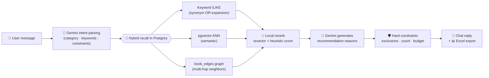

<div align="center">

# ⛴️ BookFerry

**Ferry readers across the sea of books.**

An AI-powered book recommendation platform — chat in natural language, get curated book lists
backed by hybrid retrieval that runs **entirely inside Postgres**. No vector database required.

[](https://nextjs.org)
[](https://react.dev)
[](https://typescriptlang.org)
[](https://ai.google.dev)
[](https://github.com/pgvector/pgvector)
[](LICENSE)
[](https://github.com/sky-jiangcheng/book-ferry/pulls)

[Deploy with Vercel](https://vercel.com/new/clone?repository-url=https%3A%2F%2Fgithub.com%2Fsky-jiangcheng%2Fbook-ferry&env=GOOGLE_API_KEY,DATABASE_URL&project-name=book-ferry) · [Report Bug](https://github.com/sky-jiangcheng/book-ferry/issues) · [Request Feature](https://github.com/sky-jiangcheng/book-ferry/issues)

</div>

## Why BookFerry?

Most RAG demos tell you *how* they'd work. BookFerry ships the unglamorous parts that make
recommendations actually feel right:

- 🧮 **A transparent reranker** — every point in the ranking score is documented and auditable.
  No black-box vector magic, just a formula you can read, tune, and defend. ([see it below](#-the-reranking-engine))
- 🐘 **Postgres is your vector database** — keyword recall, pgvector ANN, native full-text ranking
  and a multi-hop domain knowledge graph, all fused in one retrieval pipeline. Zero extra infra.
- 🛟 **Degrades gracefully** — every enhanced channel (semantic, full-text, graph) fails open.
  Pull the plug on any of them and recommendations keep flowing.
- 📤 **Book lists you can hand to someone** — one-click Excel export with hard constraints:
  exclude keywords, cap the count, respect the budget.

## ✨ Features

| | |
|---|---|
| 💬 **Conversational discovery** | Multi-turn chat on the [Vercel AI SDK](https://ai-sdk.dev) — describe who the reader is and what they need, Gemini does the parsing |
| 🔎 **Hybrid retrieval** | Synonym-expanded keyword recall ∪ pgvector semantic recall, with recursive-CTE knowledge-graph neighbor expansion |
| 🎯 **Heuristic reranking** | Local relevance scoring over title / category / author / description / popularity — sub-second, zero LLM cost |
| 🕸️ **Domain knowledge graph** | `book_edges` table powers 1–2 hop "readers also liked" signals, rebuilt atomically by GitHub Actions |
| 👍 **Feedback loop** | Thumbs up / down counts flow back into the ranking score |
| 🛡️ **Hard constraints** | Exclusion terms, recommendation count and total budget enforced *after* generation |
| 📊 **Excel export** | Styled book-list spreadsheets via `exceljs` |
| 🧪 **Tested** | Unit tests, typecheck, and end-to-end RAG smoke tests against any deployment |

## 🧠 How it works



The pipeline is stateless by default. [Upstash Redis](https://upstash.com) is *optional* — it adds
session memory, feedback storage and distributed rate limiting, but first-round recommendations
work without it.

## 🚀 Quick start

```bash
git clone https://github.com/sky-jiangcheng/book-ferry.git
cd book-ferry
npm install

cp .env.local.example .env.local   # fill in GOOGLE_API_KEY and DATABASE_URL
npm run dev
```

Open [http://localhost:3000](http://localhost:3000) and start asking for books.

Verify everything:

```bash
npm run test:unit    # unit tests
npm run typecheck    # types
npm run build        # production build
npm run smoke:rag    # end-to-end RAG smoke test (add RAG_BASE_URL to target any deployment)
```

## ☁️ Deploy to Vercel

<a href="https://vercel.com/new/clone?repository-url=https%3A%2F%2Fgithub.com%2Fsky-jiangcheng%2Fbook-ferry&env=GOOGLE_API_KEY,DATABASE_URL&project-name=book-ferry">
  
</a>

Only two env vars are required — a Gemini key and any Postgres connection string
([Neon](https://neon.tech) and [Vercel Postgres](https://vercel.com/postgres) both work out of the box):

```dotenv
GOOGLE_API_KEY=            # required — Gemini
DATABASE_URL=              # required — Neon / Vercel Postgres
GOOGLE_MODEL=gemini-2.0-flash

UPSTASH_REDIS_REST_URL=    # optional — session memory, feedback, rate limiting
UPSTASH_REDIS_REST_TOKEN=
NEXT_PUBLIC_APP_URL=
ALLOWED_ORIGINS=
```

### Retrieval knobs (all on by default, set `false` to disable)

| Variable | Default | What it does |
|---|---|---|
| `ENABLE_SEMANTIC_RECALL` | `true` | pgvector semantic recall (needs `GOOGLE_API_KEY` + embeddings) — ADR-0002 |
| `ENABLE_FULLTEXT_RANK` | `true` | Native PG `tsvector` full-text ranking signal — ADR-0003 |
| `ENABLE_GRAPH_NEIGHBORS` | `true` | Multi-hop domain-graph expansion (needs `book_edges`) — ADR-0004 |
| `SEMANTIC_TOP_K` | `100` | Vector recall Top-K |
| `GRAPH_SEED_COUNT` / `GRAPH_DEPTH` / `GRAPH_NEIGHBOR_LIMIT` | `10` / `2` / `100` | Graph expansion tuning (depth 1–3) |
| `EMBEDDING_MODEL` / `EMBEDDING_DIMENSIONS` | `gemini-embedding-001` / `768` | Embedding config — the dimension is validated against `books.embedding`; see below |

### Embedding dimension contract

The vector dimension is a database contract, not a free-form setting:

- `books.embedding` is the source of truth. The runtime reads the column's actual dimension and
  embeds query text at exactly that size; the backfill script does the same.
- `EMBEDDING_DIMENSIONS` only tells `scripts/vercel/init-db.mjs` which dimension to create the
  column with. An unsupported value fails fast instead of silently falling back.
- Changing it requires a migration: `node scripts/vercel/init-db.mjs --fix-dimension` (retypes the
  column and clears the stored vectors — they are re-derivable), then re-run the backfill.

## 🗄️ Database — fully automated

No manual migration steps. Ever.

- **Schema migrations** run idempotently on every Vercel build (`scripts/vercel/init-db.mjs`,
  wired via `vercel.json` — safe to re-run, non-fatal).
- **Embedding backfill + graph rebuild** run via
  [GitHub Actions](.github/workflows/db-maintenance.yml) on every push to `main` (when scripts
  change), every Monday 11:00 Beijing time, or on demand.

One-time setup: add `POSTGRES_URL` (Neon connection string) and `GOOGLE_API_KEY` to your repo's
**Settings → Secrets and variables → Actions**. The first ~50k-book embedding backfill takes about
40 minutes — trigger one run manually from the Actions tab and watch it through.

Prefer doing it by hand?

```bash
node scripts/vercel/init-db.mjs   # create tables / columns / indexes (idempotent)
npm run backfill:embeddings       # generate vectors for books missing embeddings
npm run build:book-edges          # rebuild the domain graph (supports --book-ids incremental)
```

> The scripts try to enable `pg_trgm` and `pgvector` and create the matching indexes. If your
> database doesn't allow extensions, plain `ILIKE` keyword search still works and the semantic
> channel skips itself automatically. That's the graceful degradation guarantee.

## 📡 API

| Endpoint | Description |
|---|---|
| `GET /api/health` | Database, Redis and search-mode status |
| `POST /api/rag/chat` | Book recommendation chat |
| `GET` / `POST /api/catalog/search` | Catalog search |
| `POST /api/v1/book-list/parse` | Parse a book-list requirement |
| `POST /api/v1/book-list/generate` | Generate a recommended book list |
| `POST /api/v1/book-list/export-excel` | Export the list as Excel |

## 📚 Importing books

```bash
npm run import:books -- ./data/books.json
```

## 🧮 The reranking engine

BookFerry ranks recalled books locally — no LLM tokens, no added latency. The total relevance
score in [`lib/search/query-rerank.ts`](lib/search/query-rerank.ts):

$$S_{\text{total}} = S_{\text{init}} + S_{\text{lexical}} + S_{\text{categoryMatch}} + S_{\text{joint}} + S_{\text{noOverlap}} + S_{\text{exclusion}} + S_{\text{topic}} + S_{\text{fts}} + S_{\text{graph}} + S_{\text{feedback}}$$

<details>
<summary><b>Every signal, with its exact weight</b></summary>

| Signal | Weight / rule |
|---|---|
| **Base popularity** $S_{\text{init}}$ | $0.35 \times \ln(1 + \max(0, S_{\text{base}}))$ — log-smoothed popularity from the catalog |
| **Lexical hits** $S_{\text{lexical}}$ | $3.5 \cdot H_{\text{title}} + 2.6 \cdot H_{\text{category}} + 1.4 \cdot H_{\text{author}} + 0.8 \cdot H_{\text{publisher}} + 0.6 \cdot H_{\text{description}}$ |
| **Category match** $S_{\text{categoryMatch}}$ | `+4.5` when the book's category matches the queried category (or a category alias appears in the title) |
| **Joint match bonus** $S_{\text{joint}}$ | `+1.25` when title **and** category both hit query terms |
| **Zero-overlap penalty** $S_{\text{noOverlap}}$ | `−2.75` when no text field shares any term with the query |
| **Exclusion penalty** $S_{\text{exclusion}}$ | `−10` when the book hits a user's hard exclusion term |
| **Topic fine-tuning** $S_{\text{topic}}$ | Domain boosts: health & wellness `+2.2` (title hit `+0.9`), popular science `+1.8`, biography `+2.8` (fiction `−2.6`), exact author match up to `+20` with `−4.5` for non-matches, per-board-game disambiguation `±4.5` |
| **Full-text signal** $S_{\text{fts}}$ | $4.0 \times \min(1, \text{rank}_{\text{norm}})$ — PG `ts_rank_cd` normalized within the candidate pool (ADR-0003) |
| **Graph neighbors** $S_{\text{graph}}$ | $\text{hop}^{-1} \times w_{\text{edge}}$ — `2.0` for 1-hop, `1.0` for 2-hop, scaled by edge weight (ADR-0004) |
| **User feedback** $S_{\text{feedback}}$ | $1.5 \times \ln(1 + \text{Count}_{\text{pos}}) - 0.8 \times \text{Count}_{\text{neg}}$ — well-liked books float up |

</details>

Every weight lives in one auditable file — fork it, tune it, A/B it.

## 🤝 Contributing

Contributions are welcome! Check the [open issues](https://github.com/sky-jiangcheng/book-ferry/issues),
read the [ADRs](docs/adr) to understand *why* the architecture looks the way it does, then:

```bash
npm run check   # lint + typecheck + build
npm test        # unit tests
```

## 📄 License

Released under the [MIT License](LICENSE) — free to use, fork, and build on.

---

<div align="center">
<strong>BookFerry 书渡</strong> — the ferryman that carries readers to their next favorite book.
</div>
